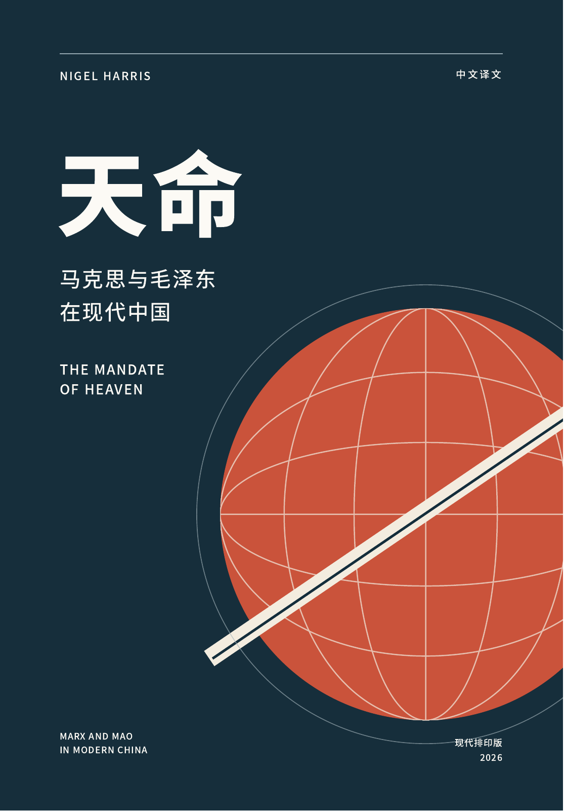

# Tianming AI Translation Project / 《天命》AI 自动翻译项目

> Chinese translation workflow archive for Nigel Harris, *The Mandate of Heaven: Marx and Mao in Modern China*.
>
> Nigel Harris《天命：马克思与毛泽东在现代中国》中文翻译流程归档。

This repository keeps the source PDF, chapter-level Markdown drafts, Codex polishing skill, build scripts, and generated PDF/HTML outputs used in the translation project.

本仓库保存该翻译项目使用的原始 PDF、逐章 Markdown 草稿、Codex 润色校对 skill、排版脚本，以及生成后的 PDF/HTML 成品。

## Modern Edition / 现代排印版



[下载 PDF](dist/天命_马克思与毛泽东在现代中国.pdf) · [HTML 阅读版](dist/mandate_of_heaven_zh.html) · [构建记录](dist/build-info.json)

2026 年 10 月 15 日修订：322 页，160 × 230 mm 开本。采用深墨蓝、暖白与朱砂红配色，宋体正文与黑体标题；在第三十六轮引文核查基础上，完成全书英文对照润色。23 个章节文件、533 条章末注释及 91 处待核标记完整保留。

The modern edition includes a new geometric cover, a compact linked contents page, 26 PDF bookmarks, and linked endnotes. The HTML embeds its fonts and supports both desktop and mobile reading. Download the HTML to read it; GitHub's file page displays its source.

生成时只显示一次章节标题，并过滤正文开头与主标题等价的旧标题行，例如“15. 外交政策”。这项处理仅发生在排版层，不修改章节 Markdown。HTML 内嵌字体，可离线阅读；来源材料链接指向 GitHub 归档。

## Full-book Polish / 全书润色

2026 年 10 月 15 日完成两篇序言、读者说明、十九章正文与回顾的对照校读。修订包括长从句拆分、语气强度复核、英语惯用表达的中文转化、错译纠正与遗漏补足；不弱化作者表述，不添加防御性观点。1,419 个段落的顺序和 1,715 处引号内文字保持不变。详见[校读记录](polish/2026-10-15.md)及[机器校验](polish/2026-10-15.json)；引文与英文底本中尚需复核的具体疑点在记录中单列。PDF、HTML、嵌入字体、目录与构建记录已同步更新。

## Citation Audit / 引文核查进度

2026 年 10 月 16 日已推进至[第四十三轮](reference%20check/2026-10-16-round43.md)：按用户提供的《人民日报》网页核定1975年3月21日第1版社论《领导干部要带头学好》，两处中文表述与FE/4862/i摘要对应。社论全文及当日六版录文检索未见07-09住房、汽车等完整目标引句，故待核仍为78处；累计147处已落实、25处部分核实、53处已检索未落实。只补第6章注14，正文不变。中文全文、中英对照及网页存档见[来源目录](reference%20check/sources/README.md)。PDF/HTML仍为10月15日润色版，尚未包含第37—43轮及校注移位修改。

## Workflow / 工作流

1. **PDF to Markdown / PDF 转 Markdown**
   - Start from the source PDF.
   - Extract or convert the book text into Markdown.
   - Clean obvious extraction errors before chapter work begins.
   - 以原始 PDF 为底本，将全文抽取或转换为 Markdown，并先清理明显的识别、换行和编码问题。

2. **Chapter Split / 章节拆分**
   - Split the full Markdown into one file per preface, chapter, or afterword under `each_chapter/`.
   - Use ASCII filenames for cross-platform stability, while keeping Chinese headings inside the files.
   - 将全文按序言、章节和回顾拆分到 `each_chapter/`，文件名使用 ASCII，正文内部保留中文标题。

3. **Codex Translation Polish / Codex 润色校对**
   - Use the local skill `skills/book-translation-polish/SKILL.md`.
   - Compare each Chinese draft against the English source.
   - Preserve every substantive claim, date, quotation, note, and citation.
   - Naturalize the Chinese prose so it reads as fluent academic Chinese rather than literal English-shaped Chinese.
   - 使用本地 `book-translation-polish` skill 逐章处理：对照英文原文，补足遗漏，统一注释编号，核查人名和引文，并把中文改写为更自然的学术表达。

4. **Citation, Notes, and Quote Check / 注释与引文复核**
   - Renumber notes from 1 in every standalone chapter file.
   - Translate explanatory note prose into Chinese while preserving bibliographic metadata.
   - For Mao Zedong, party documents, newspapers, and other Chinese-language originals, restore the original Chinese wording when reliably found.
   - 每章注释从 1 重新编号；说明性注释译为中文，书目元数据保留英文；能找到中文原文的毛泽东、党史文件和报刊引文，尽量恢复原文。
   - 用户于2026年10月16日明确批准：BBC英文记录与书中引文对应后，按书中措辞忠实回译并标明BBC出处，即视作落实；无需再取得中文原广播稿或录音。校注须说明回译性质，不称为中文原句恢复。
   - Reports, cumulative ledgers, and source scans are indexed in [reference check/](reference%20check/README.md) / 历轮核查报告、累计台账及来源扫描见该目录。

5. **Human Review / 人工校对**
   - Human proofreaders review difficult passages, terminology, quotation uncertainty, and stylistic consistency.
   - Items marked as needing original-source verification are revisited manually.
   - 人工校对负责复核疑难段落、术语、引文不确定处和整体风格一致性。

6. **Integration and PDF Build / 整合与 PDF 输出**
   - `tools/build_book_pdf.mjs` collects the chapter Markdown files, renders HTML, creates pagination metadata, and generates a PDF draft.
   - `tools/pdf_finalize.py` reads exact chapter destinations and finalizes PDF metadata and bookmarks while preserving links and embedded fonts.
   - Generated outputs live in `dist/`.
   - 汇总章节后，检查标题、正文、注释和待核标记；等待字体加载完毕，再反复排版至目录页码稳定。PDF 收尾保留原有链接与字体，成品位于 `dist/`。

## Repository Layout / 仓库结构

- `each_chapter/` - chapter-level Markdown translation drafts / 逐章中文 Markdown 草稿
- `reference check/` - citation-check reports, cumulative JSON ledgers, and source materials / 引文核查报告、累计JSON台账与来源材料
- `polish/` - full-book editorial review and preservation checks / 全书润色校读记录与引文、段落保护校验
- `skills/book-translation-polish/` - local Codex skill for translation polishing / 本项目使用的 Codex 翻译润色 skill
- `tools/` - build and PDF finalization scripts / 构建与 PDF 收尾脚本
- `dist/` - generated HTML, page-map data, table of contents data, and final PDF / 生成的 HTML、页码映射、目录数据和最终 PDF
- `README.md` - bilingual project notes and workflow / 中英双语项目说明

## Build / 构建

Requires Node.js 22+, Python 3, `marked`, `playwright`, `pypdf`, and Chrome/Edge or Playwright Chromium. The builder first uses project packages, then the Codex bundled runtime when available. Font subsets are included in `tools/fonts/`; no Windows font installation is needed for ordinary builds.

普通环境先安装依赖。已配置 Codex 工作区运行时的环境可直接运行构建命令。

```powershell
npm install
python -m pip install -r requirements.txt
# If Chrome/Edge is not installed:
npx playwright install chromium
```

```powershell
node tools/build_book_pdf.mjs
```

- `BROWSER_PATH`：自定义 Chrome/Chromium/Edge 可执行文件位置。
- `PYTHON`：Python 可执行文件位置；普通 Windows 环境可设为 `python`。
- `BUILD_DATE`：覆盖排印日期，格式 `YYYY-MM-DD`；默认使用悉尼日期。
- `NODE_PATH` / `CODEX_RUNTIME_DIR`：可选的依赖位置。

Cover artwork is authored in `tools/cover.html`; typography and print/screen styles are in `tools/book.css`. To regenerate the README cover preview after a design change:

```powershell
pdftoppm -f 1 -l 1 -scale-to 1600 -singlefile -png "dist/天命_马克思与毛泽东在现代中国.pdf" dist/cover
```

中间 PDF 和预览保存在被 Git 忽略的 `tmp/pdfs/`。`dist/build-info.json` 记录译稿来源提交、核查轮次及台账 SHA-256、各章 SHA-256、被过滤的重复标题、构建日期与稳定页码结果。新增字体子集之外的字符时，按 [字体说明](tools/fonts/README.md) 重新生成字体。

## Notes / 说明

This repository is a translation workflow archive. The original work remains the intellectual property of its author and rights holders.

本仓库是翻译工作流归档。原书版权归原作者及权利方所有。
